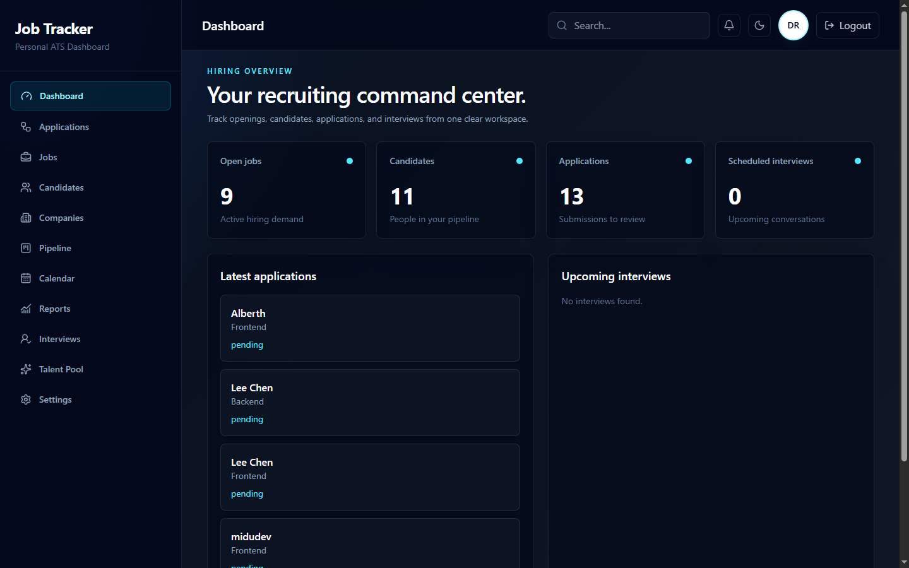
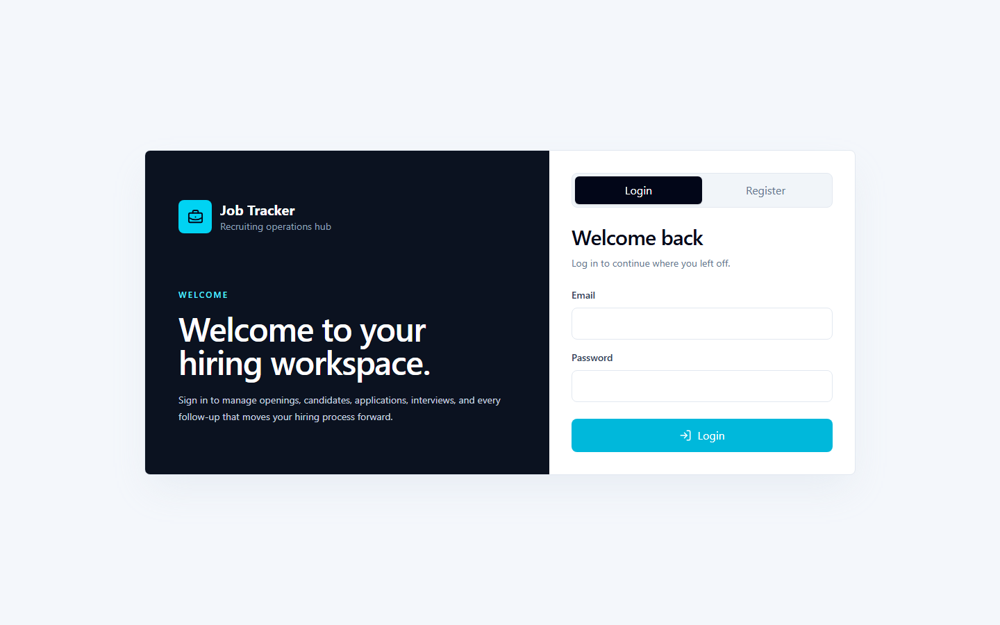
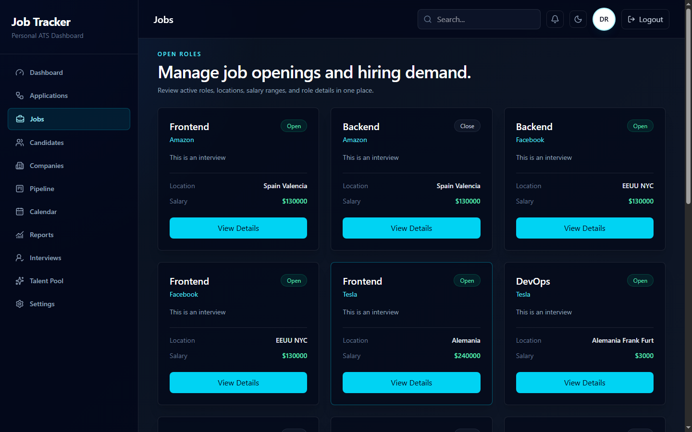
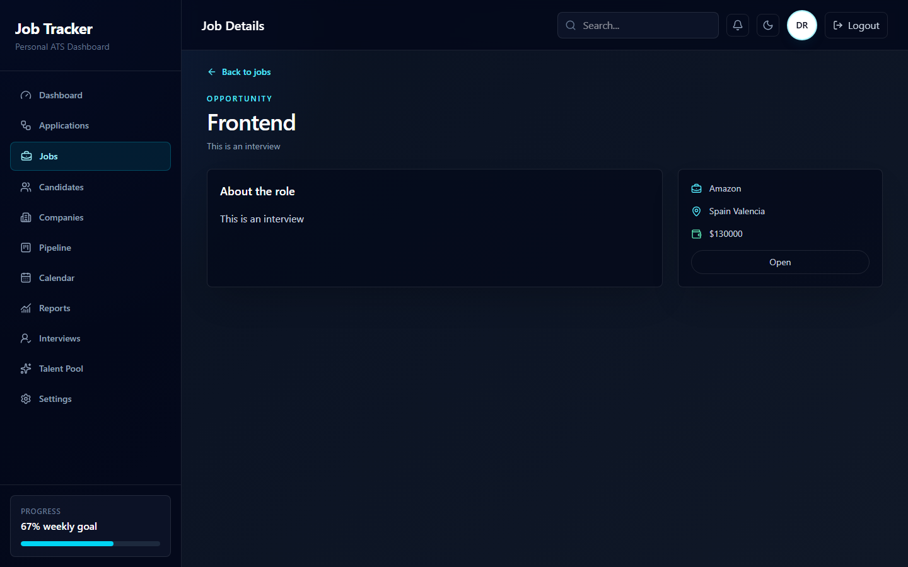
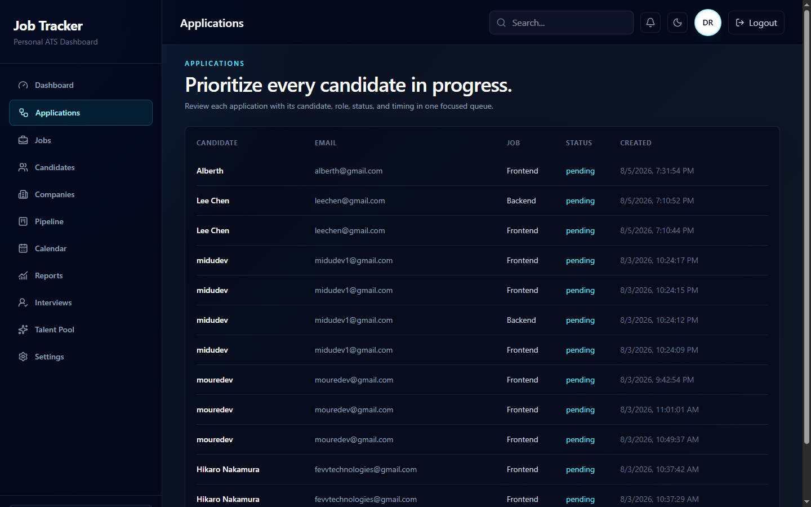
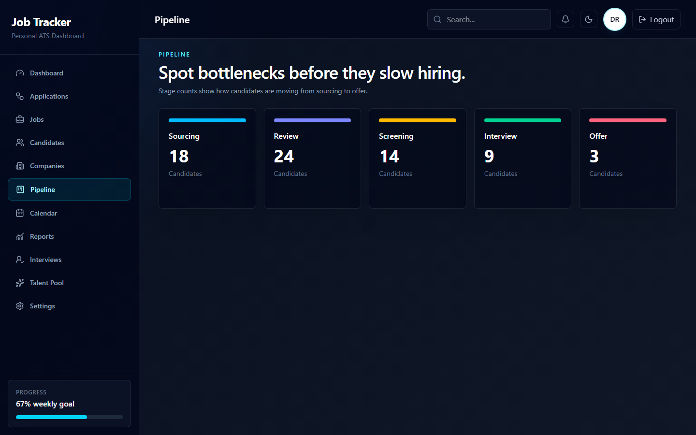
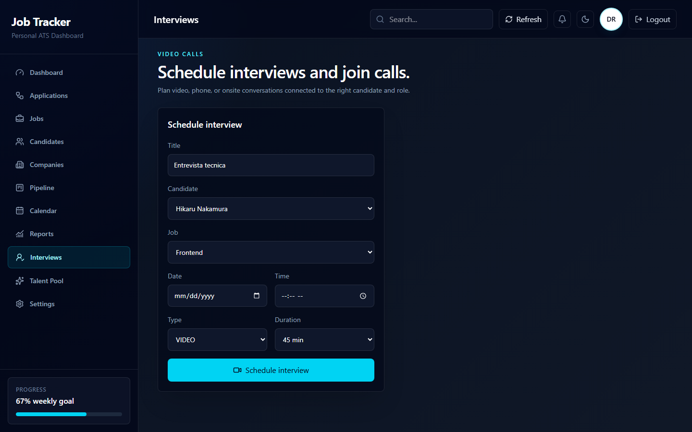
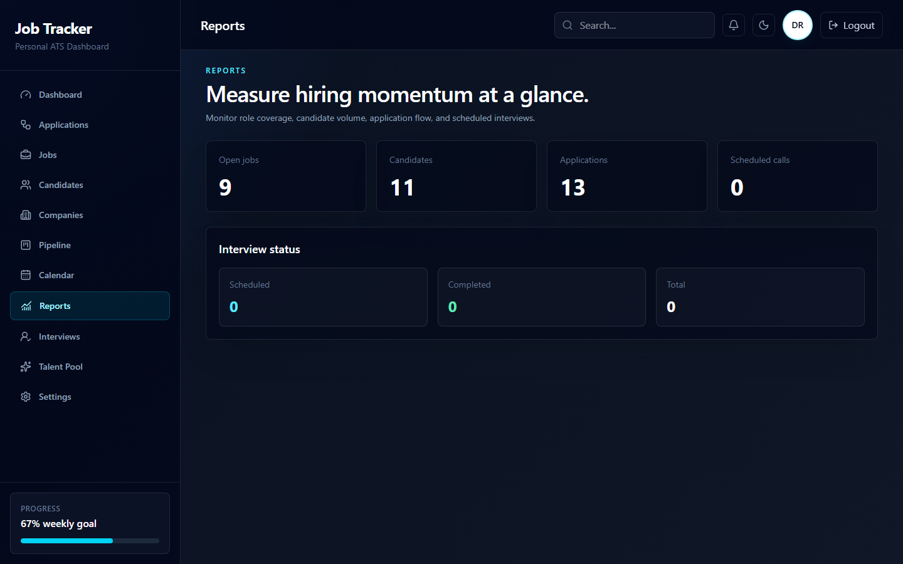
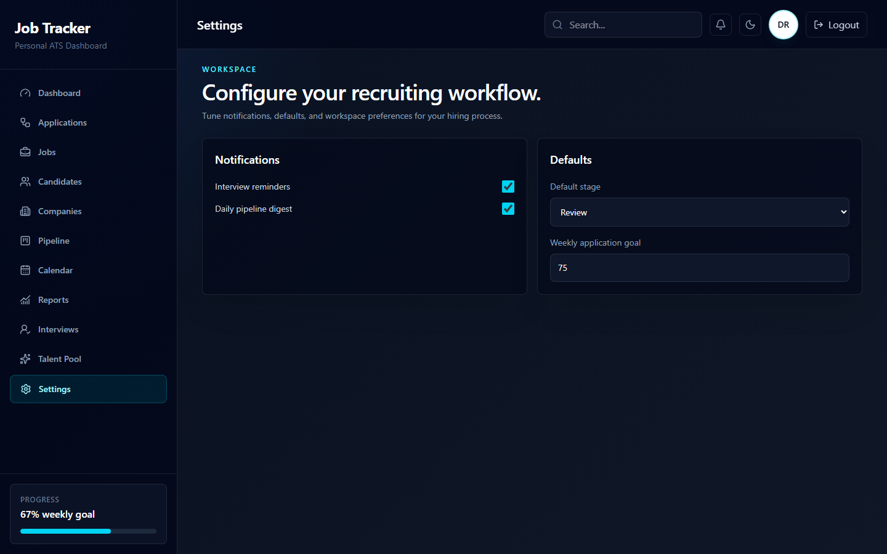

# JobTracker

JobTracker is a web application for managing recruitment workflows. It helps teams track jobs, candidates, applications, interviews, hiring pipelines, and reports from a modern React interface.



The dashboard is the landing view: key hiring counters (open jobs, candidates, applications, scheduled interviews) plus the latest applications and upcoming interviews.

## Features

- User authentication and protected routes.
- Hiring dashboard with an overview of recruitment activity.
- Job management and detailed job pages.
- Candidate, company, and application management.
- Hiring pipeline to organize candidate progress.
- Calendar and interview management.
- Interview meeting room.
- Resume/CV viewer.
- Reports and user settings.

## Screenshots

### Sign in

Recruiters and candidates share one entry point: log in, or register and pick a role. Candidates who register can attach a CV during sign-up.



### Jobs

Every opening as a card with company, location, salary, and open/closed state.



### Job details

Full role description with company, location, and salary summary.



### Applications

One queue with candidate, email, role, status, and submission time.



### Pipeline

Stage counters from sourcing to offer, to spot where candidates pile up.



### Interviews

Schedule video, phone, or onsite interviews against a candidate and a job, then join the call from the meeting room.



### Reports

Role coverage, candidate volume, application flow, and interview status at a glance.



### Settings

Notification preferences, default pipeline stage, and weekly application goal.



## Tech Stack

- React 19
- Vite 8
- React Router
- TanStack React Query
- Material UI
- Lucide React
- Tailwind CSS
- ESLint

## Backend

The frontend consumes the deployed API at:

```txt
https://cutlet-infinite-cow.abasthan.app/
```

API requests are proxied through relative frontend routes to avoid CORS issues in production. The API client is configured in `src/utils/api.js`:

```txt
/api
```

For Netlify deployments, `netlify.toml` forwards `/api/*`, `/health`, and `/uploads/*` to the deployed backend. In local development the same paths are proxied by `vite.config.js`.

## Requirements

- Node.js
- pnpm

## Installation

Clone the repository and install dependencies:

```bash
pnpm install
```

## Development

Start the local Vite development server:

```bash
pnpm dev
```

Then open the URL shown in the terminal, usually:

```txt
http://localhost:5173
```

## Scripts

```bash
pnpm dev
```

Starts the development server.

```bash
pnpm build
```

Creates a production build in `dist/`.

```bash
pnpm preview
```

Serves the production build locally.

```bash
pnpm lint
```

Runs ESLint across the project.

## Project Structure

```txt
src/
  components/   Reusable UI components
  context/      Authentication context
  Hooks/        Custom hooks
  pages/        Main application views
  utils/        API client and helpers
docs/
  screenshots/  Images used in this README
```

## Main Routes

- `/login` - Sign in.
- `/` - Dashboard.
- `/jobs` - Jobs.
- `/jobs/:id` - Job details.
- `/applications` - Applications.
- `/candidates` - Candidates.
- `/companies` - Companies.
- `/pipelines` - Hiring pipeline.
- `/calendar` - Calendar.
- `/interviews` - Interviews.
- `/call/:meetingId` - Meeting room.
- `/resume-viewer` - Resume viewer.
- `/reports` - Reports.
- `/settings` - Settings.
- `/talent` - Talent pool.

`/applications`, `/candidates`, `/companies`, `/pipelines`, `/reports`, and `/talent` are restricted to the `recruiter` and `admin` roles.

## Build

Create a production-ready build:

```bash
pnpm build
```

The final files are generated in:

```txt
dist/
```
